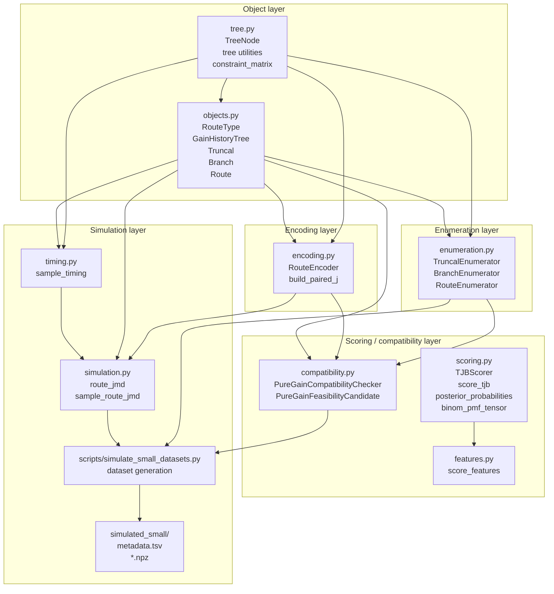
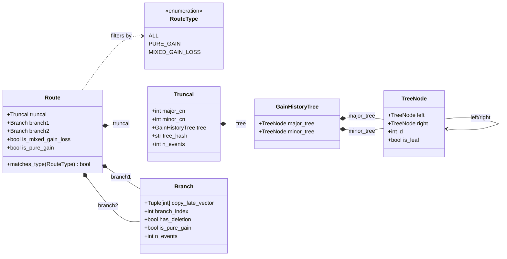
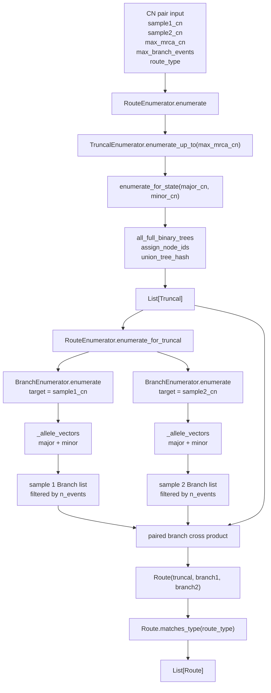
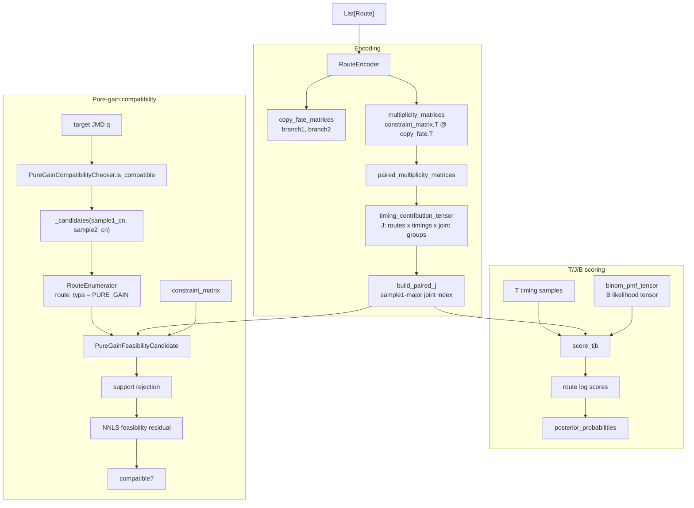
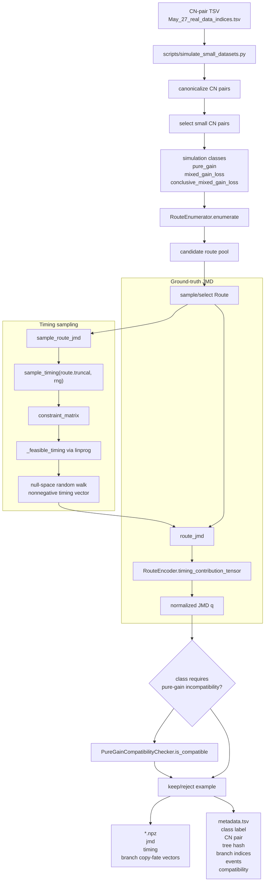

# SPUR Codex UML Diagrams

These diagrams are split by architectural layer to avoid one dense cross-module UML.

## Layered Architecture

## Object Model

## Enumeration Flow

## Encoding, Scoring, And Compatibility

## Simulation Workflow

